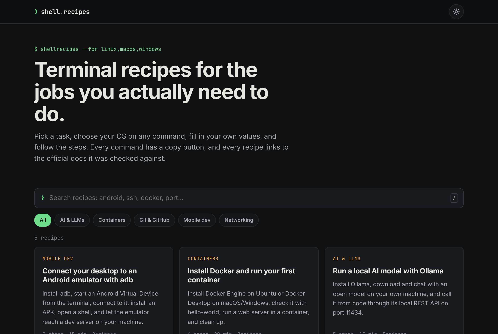
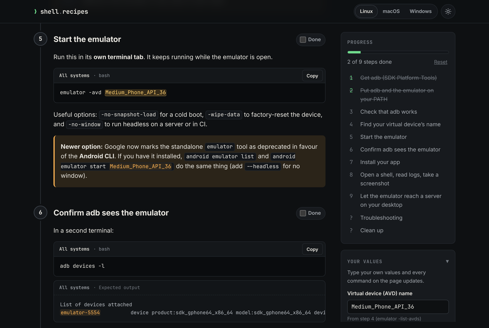
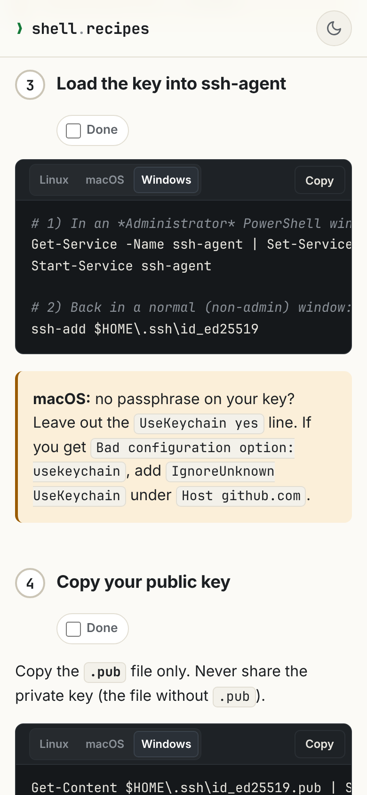

# ShellRecipes

**Step-by-step terminal recipes for real-world tasks**, with commands for Linux (bash), macOS Terminal (zsh) and Windows Terminal (PowerShell).

Pick a use case, such as *"connect my desktop to an Android emulator"*, choose your OS, fill in your own values, and follow the numbered steps.



## Features

- **OS tabs on every command.** Pick Linux, macOS or Windows on any command block and the whole page follows. Your OS is detected on the first visit and remembered.
- **Fill-in variables.** Type your port, IP, device serial or email once, and every command updates.
- **Copy buttons.** Copy each command with your values already filled in.
- **Step checklist.** Tick off steps as you go. Progress is saved in your browser and shown on the home page.
- **Expected output and troubleshooting.** Each step shows what you should see when it worked.
- **Search and categories.** Filter recipes as you type. Press <kbd>/</kbd> to focus search.
- **Sources with dates.** Each recipe lists the official docs it was checked against, plus a "verified" date.
- **Dark/light mode and mobile-friendly layout.**

| Recipe page (desktop) | Mobile, light mode |
|---|---|
|  |  |

## Recipes (v0.1)

| Recipe | Category |
|---|---|
| Connect your desktop to an Android emulator with adb | Mobile dev |
| Set up an SSH key for GitHub | Git & GitHub |
| Install Docker and run your first container | Containers |
| Run a local AI model with Ollama | AI & LLMs |
| Find and kill the process using a port | Networking |

## Run it locally

Requires **Node.js 22.23.4 or newer** (Astro 7's minimum).

```bash
npm install
npm run dev          # http://localhost:4321/
```

```bash
npm run build        # static site in dist/
npm run preview
npm run check:recipes  # lint recipe files
```

## Contributing

Recipes are open for contributions, and the maintainer reviews every one before it's published:

- **No Git needed:** fill in the [Submit a new recipe](https://github.com/AimxnAsyraf/shell-recipes/issues/new?template=new-recipe.yml) form. Once it's approved with the `approved` label, a GitHub Action turns it into a recipe file and opens a pull request.
- **Git users:** add one Markdown file to `src/recipes/` and open a pull request.

See [CONTRIBUTING.md](CONTRIBUTING.md) for the format, the review steps and the maintainer setup.

## Deploy (Cloudflare Pages)

Cloudflare Pages builds the site from GitHub and redeploys on every push to `main`. Pull requests get their own preview URLs.

1. In the Cloudflare dashboard, go to **Workers & Pages → Create → Pages → Connect to Git**, and pick `AimxnAsyraf/shell-recipes`.
2. Build settings:
   - **Framework preset:** Astro
   - **Build command:** `npm run build`
   - **Build output directory:** `dist`
3. Click **Save and Deploy**. The site goes live at `https://<project-name>.pages.dev` (default project name: `shell-recipes`).

The Node version comes from `.node-version` (Astro 7 needs Node 22.23.4 or newer, which is newer than Cloudflare's default). `public/_headers` sets caching headers, and `src/pages/404.astro` becomes the 404 page.

Using a custom domain or a different project name? Set the `SITE_URL` environment variable in the Pages project (e.g. `https://recipes.example.com`). Serving from a sub-path instead, like GitHub Pages? Build with `SITE_BASE=/shell-recipes`.

GitHub Actions (`.github/workflows/ci.yml`) only checks recipes and runs a test build on pull requests. It doesn't deploy.

## Tech

[Astro 7](https://astro.build) static site. Markdown goes through the unified/remark pipeline with two small plugins in [`src/plugins/`](src/plugins/): one turns code fences into OS-aware command blocks, the other turns `##` sections into numbered steps. There's no backend, and progress and values are stored in the visitor's browser (`localStorage`).

## License

[MIT](LICENSE) © 2026 AimxnAsyraf. Contributions are published under the same license.
